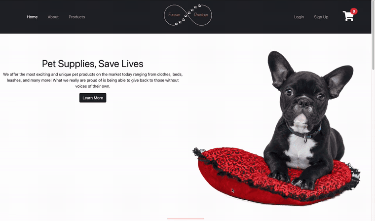
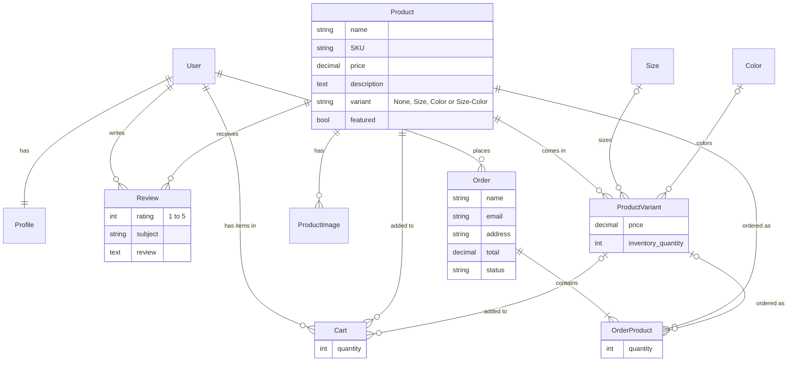

# Furever Precious

An online pet supply store built with Django. Shoppers can browse products, pick a size or color, add items to a cart, check out with Stripe, and leave star ratings and reviews. Accounts come with profiles, a review history and password reset by email, and products are managed through the Django admin with a rich-text editor.



▶️ **[Watch the full demo video](https://sangye-tenphel.s3.amazonaws.com/fureverPrecious.mp4)** (1 min 38 s, includes signing up and the profile page)

## Features

- **Product catalog:** a home page with featured products, a page of all products, and product pages with an image gallery and a rich-text description.
- **Variants:** products can come in sizes, colors or both, each with its own price, stock count and photo. Picking a size loads the colors available in that size, without reloading the page (AJAX).
- **Shopping cart:** add items, change quantities and remove items, with a running subtotal and total.
- **Stripe checkout:** payment through Stripe Checkout. A Stripe webhook marks each order as paid once the payment goes through, and orders move through statuses such as Awaiting Payment, Paid, On Shipping and Completed.
- **Ratings and reviews:** signed-in shoppers leave a 1–5 star rating and a review. Each product shows its average rating, its review count and its reviews.
- **User accounts:** sign up, log in and out, a profile with an editable picture, a list of your reviews, password change, and password reset by email.
- **Admin:** manage products, variants, images, colors, sizes and orders in the Django admin, with image thumbnails and a CKEditor rich-text editor.

## Database design



## Project structure

```
furever_precious/   Project settings and URLs
store/              Products, variants, cart, checkout, Stripe webhook and reviews
users/              Sign-up, login, profiles, password change and reset
```

## Running it locally

The pinned package versions date from 2021, so use **Python 3.9**.

```bash
python3.9 -m venv venv
source venv/bin/activate
pip install -r requirements.txt
python manage.py migrate
python manage.py createsuperuser
python manage.py runserver
```

Open http://127.0.0.1:8000, and add products at http://127.0.0.1:8000/admin.

Payments and emails need these environment variables:

| Variable | Used for |
|---|---|
| `STRIPE_PUB_KEY`, `STRIPE_SECRET_KEY` | Stripe test-mode keys from your [Stripe dashboard](https://dashboard.stripe.com/test/apikeys) |
| `STRIPE_ENDPOINT_SECRET` | The webhook signing secret (for local testing, run `stripe listen --forward-to localhost:8000/webhook` with the Stripe CLI) |
| `EMAIL_USER`, `EMAIL_PASS` | The account that sends password-reset emails |
| `DJANGO_SECRET_KEY` | Your own secret key, for anything beyond local development |
| `DJANGO_DEBUG` | Set to `False` to turn debug mode off |
| `DJANGO_ALLOWED_HOSTS` | The site's domain(s), comma-separated, when deploying (default `localhost,127.0.0.1`) |

The site runs without the Stripe and email settings, but checkout and password reset won't work.

## Built with

- **Backend:** Python, Django 3.2, Stripe API, django-ckeditor, django-crispy-forms and Pillow
- **Frontend:** HTML, CSS, Bootstrap and JavaScript (AJAX for the cart and the color options)
- **Storage:** SQLite locally; PostgreSQL and AWS S3 (django-storages, boto3) were used in production

Created by Sangye Tenphel, 2021.
